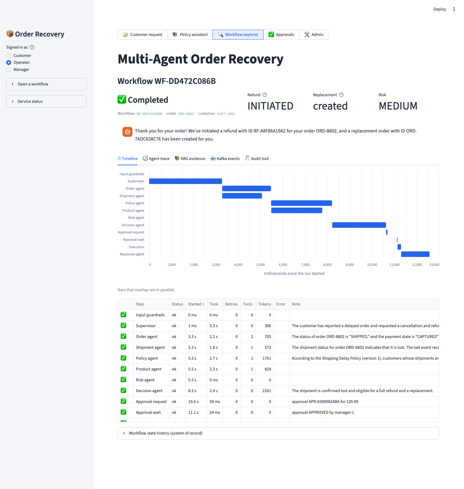

# Streamlit UI

Internal demo and operations console for the order recovery platform.

| Page | Who | What |
|---|---|---|
| Customer request | everyone | enter customer, order and request; run **live** (each agent step streams in) or **queued** (workflow-service + Kafka); the workflow viewer below updates itself until the run ends |
| Policy assistant | everyone | ask the policy RAG directly; see confidence, grounding, the cited answer and every retrieved passage |
| Workflow explorer | everyone (own workflows) / staff (all) | one workflow in five tabs: timeline, agent trace, RAG evidence, Kafka events, audit trail |
| Approvals | operator, manager | pending approvals with amount, reason, risk, expiry and the agents' evidence; a manager approves or rejects |
| Admin | operator, manager | workflow list, failures, compensation steps, cost and token usage, RAG quality, live Kafka feed |



## Panels
- **Timeline**: a Gantt chart of every step (overlapping bars ran in parallel) with status, retries, tool calls, tokens and errors.
- **Agent trace**: supervisor reasoning and decision, specialist table, every MCP tool call, model calls, tokens and cost per agent, latency per step.
- **RAG evidence**: confidence, grounding status, the answer with `[n]` citations, all retrieved passages with relevance and reranker scores, whether each was shown to the model and whether it was cited; plus per-stage timings, withheld passages and any grounding issues.
- **Kafka events**: topic, type, correlation and causation ids, delivery state, payload inspector.
- **Admin**: failed and escalated workflows, compensation steps (reserved stock released, refund kept), cost per run, RAG abstention/cache/latency metrics and the recent questions the policy could not answer (candidates for new golden-set cases).

## Personas and security
The sidebar switches between **Customer**, **Operator** and **Manager**. This is a demo stand-in for user authentication (put an authenticating gateway in front for real use). The UI sends the service token plus `X-Customer-Id` / `X-Roles`; the backend services enforce ownership and roles themselves (a customer cannot open someone else's workflow, only a manager can decide an approval), so the UI is not a security boundary.

## Deep links
`?as=manager&wf=WF-123&page=Approvals` opens the app as that persona on that workflow or page (first load only; the URL then follows the selected workflow, so it can be shared). Pages: `Customer request`, `Policy assistant`, `Workflow explorer`, `Approvals`, `Admin`.

## Configuration
`STREAMLIT_API_BASE_URL` (workflow-service), `STREAMLIT_APPROVAL_API_BASE_URL`, `AGENT_HOST_URL`, `AUDIT_SERVICE_URL`, `STREAMLIT_SERVICE_TOKEN` (falls back to `MCP_SERVICE_TOKEN`). In Docker Compose these point at the service names.

## Develop and test
```bash
uv venv --python 3.12 .venv-ui && uv pip install --python .venv-ui/bin/python -r streamlit-ui/requirements-dev.txt
cd streamlit-ui && ../.venv-ui/bin/streamlit run app.py          # http://localhost:8501
../.venv-ui/bin/python -m pytest -q                              # 48 tests, no backend needed
python scripts/live_smoke.py --order ORD-8801                    # drives the real UI against the running stack (real model calls)
python scripts/screenshot.py "<url>" out.png --click "RAG evidence"   # Chrome screenshots, used for docs
```
Structure: `api_client.py` (all HTTP, typed errors, SSE), `data.py` (pure shaping of API data, unit-tested), `components/` (one module per panel), `app.py` (personas, navigation, deep links). Tests render the real app headlessly with Streamlit's `AppTest` against a fake API.

## Notes
- Live mode needs the agent host reachable from the UI; queued mode needs Kafka. The sidebar's *Service status* shows what is up.
- The workflow viewer refreshes every 3 seconds until the workflow reaches a final state.
- Demo data: orders `ORD-7842`, `ORD-8801` to `ORD-8804` are lost shipments owned by `CUST-1001`; each can be refunded once (`make clean` resets).
